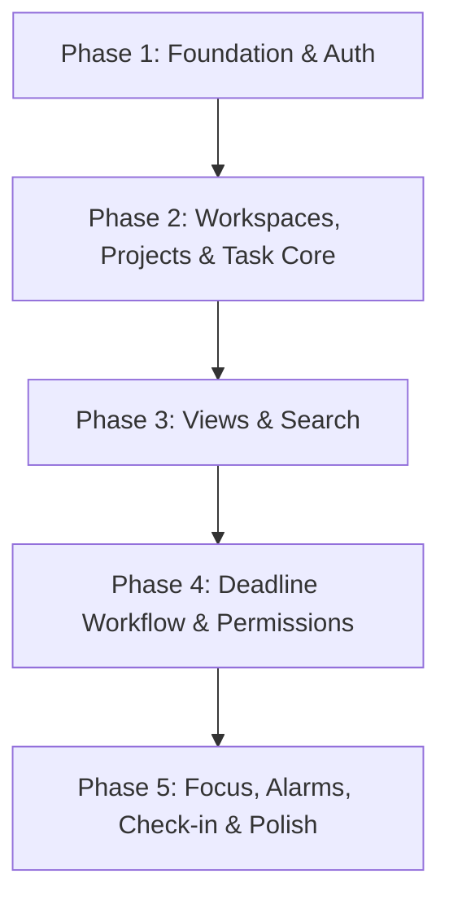

# Wenlo Todos (`wenlo-todos`)

> readme Made using AI
>
> **A modern, collaborative, multi-tenant productivity and task execution suite.**  
> Built with Turborepo, Next.js, React + Vite + TypeScript, Supabase, and Tailwind CSS with custom variable-driven themes.

---

## Table of Contents

1. [Project Overview](#project-overview)
2. [Tech Stack & Architecture](#tech-stack--architecture)
3. [Monorepo Structure & Quick Start](#monorepo-structure--quick-start)
4. [Design System & Theming](#design-system--theming)
5. [Version & Phase Plan](#version--phase-plan)
   - [V1 — Core Product (Deadline: Oct 10)](#v1--core-product-deadline-oct-10)
     - [Features Cut from V1 (Deferred to V2)](#features-cut-from-v1-deferred-to-v2)
     - [V1 Phase Breakdown (Phases 1–5)](#v1-phase-breakdown)
   - [V2 — Depth & Collaboration](#v2--depth--collaboration)
   - [V3 — Analytics, Automation & Advanced Search](#v3--analytics-automation--advanced-search)
   - [V4 — Native Platforms & Integrations](#v4--native-platforms--integrations)
   - [V5 — Enterprise & Scale](#v5--enterprise--scale)
   - [Version Roadmap Summary](#version-roadmap-summary)
6. [Master Feature List](#master-feature-list)
   - [Feature Legend](#feature-legend)
   - [1. Workspace & Access Control](#1-workspace--access-control)
   - [2. Hierarchical Logging & Audit Governance](#2-hierarchical-logging--audit-governance)
   - [3. Smart Input & Task Capture](#3-smart-input--task-capture)
   - [4. Task Architecture & Structure](#4-task-architecture--structure)
   - [5. Deadline & Schedule Management](#5-deadline--schedule-management)
   - [6. Project & Space Management](#6-project--space-management)
   - [7. People (Peps) & Assignments](#7-people-peps--assignments)
   - [8. Collaboration & Discussion](#8-collaboration--discussion)
   - [9. Notes & Versioning](#9-notes--versioning)
   - [10. Questions & Clarifications](#10-questions--clarifications)
   - [11. Tag Management](#11-tag-management)
   - [12. Time Tracking & Reporting](#12-time-tracking--reporting)
   - [13. Views & Dashboards](#13-views--dashboards)
   - [14. Filtering & Search](#14-filtering--search)
   - [15. Sharing & Guest Access](#15-sharing--guest-access)
   - [16. Notifications, Alarms & Reminders](#16-notifications-alarms--reminders)
   - [17. Focus & Time Management](#17-focus--time-management)
   - [18. Focus & Productivity Analytics](#18-focus--productivity-analytics)
   - [19. Automation & Webhooks](#19-automation--webhooks)
   - [20. Templates & Import / Export](#20-templates--import--export)
   - [Open Questions & Architectural Notes](#open-questions--architectural-notes)
   - [Feature Count Summary](#feature-count-summary)
7. [Roles & Permissions Matrix](#roles--permissions-matrix)
   - [Symbol Key & Legend](#symbol-key--legend)
   - [Role Hierarchy](#role-hierarchy-highest--lowest)
   - [Matrix Sections 1–22](#matrix-sections)
   - [Removed / Fully Excluded Matrix Sections](#removed-matrix-sections)
8. [Raw Feature Notes & Brainstorming Archive](#raw-feature-notes--brainstorming-archive)
9. [How to Run Everything Locally](#9-how-to-run-everything-locally)

---

## Project Overview

**Wenlo Todos** is an enterprise-grade yet tactile productivity application engineered to handle personal focus, high-accountability team workflows, and complex project governance. It bridges personal daily execution (Pomodoro, habit tracking, personal sandboxes) with multi-tenant organization management (cascading RBAC, hierarchical audit logs, formal deadline renegotiation protocols).

---

## Tech Stack & Architecture

| Layer                          | Technologies & Specs                                                        | Notes                                                              |
| ------------------------------ | --------------------------------------------------------------------------- | ------------------------------------------------------------------ |
| **Monorepo**                   | Turborepo + pnpm workspaces                                                 | High-efficiency task caching & pipeline execution                  |
| **Marketing Site (`abc.tld`)** | Next.js (App Router, Static Generation)                                     | Fast SEO-optimized landing pages                                   |
| **Web App (`app.abc.tld`)**    | React + Vite + TypeScript                                                   | Client-only SPA for responsive, latency-free state updates         |
| **Styling**                    | Tailwind CSS + CSS Custom Properties (`var(--...)`)                         | Themeable design system with seamless Light/Dark mode switching    |
| **Typography**                 | Inter & Manrope                                                             | Clean modern typography for dense data and productivity dashboards |
| **State Management**           | Zustand                                                                     | Scalable, modular client state                                     |
| **Backend & Database**         | Supabase (PostgreSQL + Realtime + RLS)                                      | Strict Row Level Security policies per workspace/project           |
| **Authentication**             | Supabase Auth (OTP email client service, passwordless, Google OAuth, Apple) | Auto-password generation flows & secure session tokens             |
| **Local / Offline Engine**     | SQLite / WatermelonDB (Roadmap)                                             | Offline-first sync capability                                      |
| **Native Wrappers**            | Capacitor (Mobile iOS/Android) + Electron (Desktop)                         | Roadmap for native notifications, system tray, & geofencing        |
| **Deployment**                 | Vercel                                                                      | Multi-project setup from a single monorepo                         |

---

## Monorepo Structure & Quick Start

```bash
wenlo-todos/
├── apps/
│   ├── marketing/          # Next.js static marketing and landing site
│   └── web/                # React + Vite client-only SPA (app.abc.tld)
├── packages/
│   ├── ui/                 # Shared UI components and primitives
│   ├── eslint-config/      # Shared linting configs
│   └── typescript-config/  # Shared tsconfig definitions
├── static-landing/         # Prototype / static landing assets & stylesheets
├── turbo.json              # Turborepo task pipeline configuration
├── pnpm-workspace.yaml     # pnpm workspace definition
└── package.json            # Root configuration scripts
```

### Prerequisites

- **Node.js**: `>= 24`
- **Package Manager**: `pnpm` (`^11.x` recommended)
- **Turbo**: Global or via `pnpm dlx turbo`

### Getting Started

1. **Clone the repository and install dependencies:**

   ```sh
   git clone <repo-url> wenlo-todos
   cd wenlo-todos
   pnpm install
   ```

2. **Run local development servers:**

   ```sh
   pnpm dev
   # or with global turbo:
   turbo dev
   ```

3. **Build all applications and packages:**

   ```sh
   pnpm build
   # or target a specific package:
   turbo build --filter=marketing
   ```

4. **Lint and Typecheck:**
   ```sh
   pnpm lint
   pnpm check-types
   ```

---

## Design System & Theming

The user interface uses a tactile aesthetic featuring **horizon-line separations** and a **scratch-off completion animation** on task completion.

### Themes & Color Modes

The styling engine uses CSS variable swapping via `:root` attributes:

- **Charcoal**: Minimalist slate and deep ink tones.
- **Sand**: Warm, neutral, earthy paper textures.
- **Midnight**: High-contrast modern dark mode with subtle neon accents.

Each theme supports both **Light** and **Dark** variants (6 combinations total), persisted across reloads via `localStorage`.

---

## Version & Phase Plan

> **V1 Target Deadline:** October 10 (~22 Days)  
> **Core Stack:** Turborepo + pnpm, Vite + React + TS, Supabase, Tailwind CSS.  
> Phases are ordered strictly by technical dependency and delivery priority.

---

### V1 — Core Product (Deadline: Oct 10)

> **Goal:** Deliver a shippable, demo-ready collaborative todo application covering all core manager-mandated non-negotiables implemented at their leanest valid form.

#### Features Cut from V1 (Deferred to V2)

| Cut from V1                                       | Deferred To | Rationale / V1 Fallback                     |
| ------------------------------------------------- | :---------: | ------------------------------------------- |
| Eisenhower Matrix view                            |   **V2**    | V1 focuses on List, Kanban, and Smart Lists |
| Command Palette (`Cmd+K` / `Ctrl+K`)              |   **V2**    | V1 uses standard top/sidebar navigation     |
| Saved personal filter views                       |   **V2**    | Fixed quick-filters only in V1              |
| Custom per-project status workflows               |   **V2**    | Fixed standard statuses in V1               |
| Sub-projects / nested projects                    |   **V2**    | Flat single-level project hierarchy in V1   |
| Multi-level subtasks beyond 1 level               |   **V2**    | Single-level subtasks in V1                 |
| Progress bar auto-calculation                     |   **V2**    | Manual checklist / status tracking          |
| Task dependencies (Blocks/Blocked By)             |   **V2**    | Deferred to collaboration phase             |
| Task flags (Blocked, Needs Review, At Risk)       |   **V2**    | Prioritized standard P1–P4 priorities       |
| Recurring tasks (RRULE schedules)                 |   **V2**    | Static deadlines in V1                      |
| Multi-homing tasks                                |   **V2**    | One project per task in V1                  |
| Automated backend deadline escalation alerts      |   **V2**    | Visual overdue indicators on cards          |
| Custom fields                                     |   **V2**    | Standard task fields only                   |
| Project templates, clone, import/export           |   **V2**    | Manual project creation in V1               |
| Detailed focus session analytics (charts, trends) |   **V2**    | Simple counts and totals list in V1         |
| Focus session analytics (graphical charts)        |   **V2**    | Raw log list in V1                          |
| Check-in history view                             |   **V2**    | Current-day check-in only in V1             |
| Task-based alarms                                 |   **V2**    | App-open scheduled alarms in V1             |

---

#### V1 Phase Breakdown



#### Phase 1: Foundation & Auth

- **Infrastructure:**
  - Turborepo + pnpm monorepo scaffold.
  - App: Vite + React + TypeScript SPA (`app.abc.tld`).
  - Marketing: Next.js static site (`abc.tld`).
  - Tailwind CSS + CSS variable theming (Charcoal, Sand, Midnight × Light/Dark).
  - Supabase integration (PostgreSQL + Auth + Realtime).
- **Database Schema & Migrations:**
  - Tables: `workspaces`, `projects`, `tasks`, `subtasks`, `peps` (users), `memberships`, `roles`, `focus_sessions`, `alarms`, `checkins`.
  - Row Level Security (RLS) policies configured for workspace and project boundaries.
- **Authentication:**
  - Supabase Auth: Email + OTP passwordless login.
  - Google OAuth integration.
  - Dual login flow: OTP and password support.
  - Auto-password creation: Verified Google users attempting password login can create passwords after OTP verification.
  - Protected routing and session persistence.
- **Landing Page:**
  - Hero, features overview, CTAs for signup and login, static deployment on Vercel.

#### Phase 2: Workspaces, Projects & Task Core

- **Workspaces & People:**
  - Workspace creation with unique display identifiers.
  - Email invitations to join workspaces.
  - Workspace People (`peps`) directory.
  - 4 V1 Roles:
    - **Owner:** Complete control.
    - **Admin:** Manages projects, tasks, members (cannot modify roles at or above own level).
    - **Manager:** Manages tasks and members within assigned projects.
    - **Member:** Creates and manages assigned tasks.
- **Projects:**
  - Create / edit / delete projects (flat, no nesting in V1).
  - Project membership independent of workspace membership.
  - Visibility toggles: Public to workspace vs. Private to project members.
- **Tasks Core:**
  - Full CRUD for tasks (Title, Description, Due Date, Priority P1–P4, Status, Assignee).
  - Single-level subtasks.
  - Fixed statuses: `To Do`, `In Progress`, `Review`, `Scheduled`, `Completed`, `On Hold`.
  - Assign/unassign tasks to workspace members.
  - Active/Done split with horizon-line demarcation and scratch-off animation.
  - Bulk "Clear completed tasks".
  - Theme switcher with `localStorage` persistence.

#### Phase 3: Views & Search

- **Views:**
  - **List View:** Active/Done split sorted by due date and priority.
  - **Kanban View:** Column drag-and-drop powered by `@dnd-kit`, columns mapped to task statuses.
  - **Temporal Smart Lists:** `Today`, `Upcoming`, `This Week`, `Overdue`, and `All`.
- **Search & Filtering:**
  - Fuzzy search on title and assignee powered by `Fuse.js`.
  - Filter bar: Status, Priority, Due Date, and Assignee.

#### Phase 4: Deadline Workflow & Permissions

- **Deadline Workflow:**
  - Due date field with dynamic overdue visual badges.
  - Formal renegotiation workflow states: `Pending`, `Accepted`, `Rejected`, `Revision Requested`.
  - Mandatory inline text justification for rejections and revision requests.
  - Supervisor approval/rejection interface.
- **Permissions Enforcement:**
  - Strict role-based action guards on create, edit, and delete operations.
  - Task isolation scoped strictly to project memberships.
  - Private project access control enforcement.

#### Phase 5: Focus, Alarms, Daily Check-in & Polish

- **Pomodoro & Focus:**
  - Pomodoro timer: 25m focus / 5m short break / 15m long break + Stopwatch mode.
  - Focus session state persistence across browser refreshes via `localStorage`.
  - User session logging: Task name, session type, duration, timestamp.
  - Focus log list (reverse chronological).
  - Daily metrics: Total sessions today, total focus time, current streak (counts and totals).
- **Alarms:**
  - App-open alarms: Scheduled prompts that notify the user upon returning/opening the app.
  - In-tab browser notification delivery via Notifications API + in-app modals.
  - Actionable prompt responses: `Accept`, `Snooze`, `Dismiss`.
- **Daily Check-in:**
  - Workspace-scoped daily standup modal shown on first login of the day.
  - Prompts: _What did you do yesterday?_, _What are you doing today?_, _Any blockers?_.
  - Aggregated view visible to workspace Admins and Managers.
- **Application Polish:**
  - Empty states, loading skeleton screens, React error boundaries, form validation with inline errors.
  - Fully responsive desktop and tablet layouts.
  - Production deployment to Vercel.

---

### V2 — Depth & Collaboration

- **Restored V1 Cut List:**
  - Eisenhower Matrix 2×2 auto-sorting view (Urgent vs. Important).
  - Global Command Palette (`Cmd+K` / `Ctrl+K`).
  - Saved personal custom filters.
  - Custom per-project status workflows.
  - Nested projects (up to 3 levels deep).
  - Multi-level subtasks (up to 3 levels deep).
  - Auto-calculating subtask progress bars.
  - Task dependencies (`Blocks`, `Blocked By`, `Relates To`, `Duplicate Of`).
  - Task flags (`Blocked`, `Needs Review`, `At Risk`).
  - Completion-driven recurring RRULE schedules.
  - Multi-homing tasks across projects.
  - Automated backend escalation alerts for missed deadlines.
  - Project-level custom fields.
  - Project templates, duplication/cloning, and JSON export/import.
  - Rich graphical focus analytics and productivity trend charts.
  - Check-in history logs per user.
  - Specific task-tied alarms.
- **Collaboration Features:**
  - Threaded task comments with `@mentions` and inline reactions.
  - Edit and delete own comments with creator/senior ownership checks.
  - Pin, resolve, and convert comments directly into actionable tasks.
  - Itemized Q&A threads with visual resolution badges.
  - Task notes with version history tracking and rollback.
  - File attachments (up to 50MB) with Cloud CDN integration.
  - In-browser audio note recording (up to 180s) with automated speech-to-text transcription.
  - Tag management: Personal (Local) tags and Workspace (Universal) tags.
- **Security & Roles Expansion:**
  - Full 9-tier RBAC: Owner, Head Admin, Admin, Manager, Sub-Manager, Member, Guest, Contributor, Viewer.
  - Cascading hierarchical permission inheritance.
  - Workspace SSO & 2FA enforcement flags.
- **External Sharing:**
  - Public share links with password protection, expiration dates, and revocation controls.
  - Restricted guest access (assigned-tasks-only, comment-only).
  - Audit trail for public link access.
- **Additional Layouts:**
  - Mind Map view with visual node-to-task conversion.
  - Split-screen workspace view.
  - Task pinning and canvas sticky notes.

---

### V3 — Analytics, Automation & Advanced Search

- **Advanced Views:** Interactive Gantt charts, Timeline view, and full-featured Calendar view with manual task placement.
- **Analytics & Gamification:**
  - Karma points engine with tier progression (_Beginner_ to _Karma Master_).
  - Habit tracking engine with daily streaks, personal frequency goals, and midnight auto-resets.
  - Team Pomodoro focus logs and velocity analytics.
  - Workspace-wide gamification leaderboards with privacy toggles.
  - SLA tracking and automated escalation workflows.
- **Time Tracking:**
  - Native task time logging with billable vs. non-billable categorization.
  - Team time audit views and CSV/payroll export tools.
- **Dashboards & Custom Reporting:**
  - Customizable workspace dashboards with PDF/image export.
  - Scheduled automated report emails.
  - Workspace-wide default views and smart list configurations.
- **Audit Governance:**
  - Hierarchical activity logging: Supervisors inspect logs strictly scoped to roles below them.
  - Exportable audit trail logs with configurable retention periods per tier.
- **Automation Engine:**
  - Event-driven automation rules (Trigger -> Condition -> Action).
  - Outgoing webhooks with configurable security scopes and custom payload structures.
- **Advanced Search & Smart Input:**
  - Custom Filter Query Language (FQL) supporting AST grammar and Boolean operators (`AND`, `OR`, `NOT`).
  - AST-based quick-add parser: `!p1–!p4` (priority), `@user` (assignee), `#project`, `+tag`, and natural dates/times.
  - Inbound email-to-task routing addresses.
- **Template Library:**
  - Shared organizational project and task template library with relative date offsets.

---

### V4 — Native Platforms & Integrations

- **Mobile Applications (Capacitor):**
  - Native iOS and Android builds.
  - Push notifications via Firebase Cloud Messaging (FCM) and Apple Push Notification service (APNs).
  - Geofence location-based reminder triggers (On-Arrive / On-Leave within 50m–10km).
  - Native OS share sheet integration.
- **Desktop Application (Electron):**
  - Native desktop wrappers for macOS and Windows.
  - System tray quick-add and system-level hotkeys.
  - Offline-first operation using SQLite + WatermelonDB client synchronization.
- **Calendar & Mail Ecosystem:**
  - Two-way real-time calendar synchronization (Google Calendar, Outlook, Apple Calendar).
  - Interactive calendar time-blocking with collision handling.
  - Direct email forwarding with automatic attachment extraction.
  - Voice-to-task creation engine.

---

### V5 — Enterprise & Scale

- **Enterprise Governance:**
  - SAML 2.0 and OIDC Enterprise Single Sign-On.
  - Strict compliance-grade data retention and automated backup policies.
  - Workspace white-labeling and custom domain branding.
- **Organizational Insights:**
  - Team workload distribution, capacity planning, and sprint velocity charts.
- **Developer Platform:**
  - Public REST & GraphQL APIs with developer portal and scoped API tokens.
  - Organization-wide webhook dispatching.
- **Subscription & Billing Engine:**
  - Tiered plan enforcement, seat-based billing, payment gateway integrations, invoice history.

---

### Version Roadmap Summary

| Version | Target / Focus                      | Key Deliverables                                                                                                                                                                                                                                                           |
| :-----: | ----------------------------------- | -------------------------------------------------------------------------------------------------------------------------------------------------------------------------------------------------------------------------------------------------------------------------- |
| **V1**  | **Core Non-Negotiables** _(Oct 10)_ | Auth, 1-level subtasks, flat projects, multi-tenant workspaces, people directory, 4 roles, List & Kanban views, Smart Lists, fuzzy search, formal deadline renegotiation, project-scoped RLS, Pomodoro & Stopwatch, app-open alarms, daily check-in, Next.js landing page. |
| **V2**  | **Depth & Collaboration**           | Restores all V1 cuts, comments, Q&A, versioned task notes, attachments, audio transcription, full 9-tier RBAC, Eisenhower & Mind Map views, tags, public sharing links.                                                                                                    |
| **V3**  | **Analytics & Automation**          | Gantt, Timeline, Calendar, Karma gamification, time tracking, dashboards, FQL search, AST syntax parsing, hierarchical supervisor audit logs, automation rules.                                                                                                            |
| **V4**  | **Native Platforms**                | iOS/Android via Capacitor, Desktop via Electron, offline sync (WatermelonDB), 2-way Google/Apple calendar sync, geofencing, voice input.                                                                                                                                   |
| **V5**  | **Enterprise & Scale**              | SAML/OIDC SSO, custom branding, workload capacity metrics, public REST API, automated billing & seat management.                                                                                                                                                           |

---

## Master Feature List

### Feature Legend

|     Tag      | Definition                                                                      |
| :----------: | ------------------------------------------------------------------------------- |
|    `[in]`    | **In Scope:** Scheduled for implementation.                                     |
|  `[future]`  | **Future:** Post-V1 roadmap item (deferred to V2–V5).                           |
|   `[out]`    | **Explicitly Excluded:** Intentionally removed or scratched out.                |
|    `[?]`     | **Clarification Required:** Needs product or technical resolution.              |
| `[research]` | **Research Required:** In scope, but requires exploratory spikes before coding. |
|   `*(F)*`    | **Universal Feature:** Flagged as universal across roles in governance docs.    |

---

### 1. Workspace & Access Control

| Feature                                                                                                     | Status |
| ----------------------------------------------------------------------------------------------------------- | :----: |
| Multi-tenant workspaces (one person, multiple workspaces)                                                   | `[in]` |
| Isolated personal scope sandboxes (personal tasks, separate from workspace)                                 | `[in]` |
| Tree-structured nested projects (max 3 levels deep)                                                         | `[in]` |
| Cascading permission inheritance down role hierarchy                                                        | `[in]` |
| Granular RBAC — 9 roles: Owner, Head Admin, Admin, Manager, Sub-Manager, Member, Guest, Contributor, Viewer | `[in]` |
| Scope-based security separation (Personal / Workspace / Project)                                            | `[in]` |
| SSO enforcement                                                                                             | `[in]` |
| 2FA enforcement                                                                                             | `[in]` |
| API key management                                                                                          | `[in]` |
| Invite / remove users from workspace                                                                        | `[in]` |
| Suspend / deactivate users                                                                                  | `[in]` |
| Change user roles (hierarchy-scoped — cannot change roles at or above own level)                            | `[in]` |
| Set workspace-wide default permissions                                                                      | `[in]` |
| View billing history and invoices _(F)_                                                                     | `[in]` |
| Manage workspace branding and white-labeling _(F)_                                                          | `[in]` |
| Configure data retention and backup policies                                                                | `[in]` |
| Manage integrations and API tokens                                                                          | `[in]` |
| Transfer workspace ownership                                                                                | `[in]` |
| Manage custom roles                                                                                         | `[in]` |

---

### 2. Hierarchical Logging & Audit Governance

| Feature                                                                               |         Status          |
| ------------------------------------------------------------------------------------- | :---------------------: |
| Workspace-wide activity and security audit logs                                       |         `[in]`          |
| View activity logs of subordinate roles (scoped to roles strictly below in hierarchy) |         `[in]`          |
| Export hierarchical audit logs and activity histories                                 |         `[in]`          |
| Configure activity log retention periods and visibility depth per role tier           |         `[in]`          |
| Approve or decline deadline adjustment requests on behalf of assignees                |         `[in]`          |
| Configure automated SLA escalation logs and auto-reassignment targets                 | `[out]` _(Crossed out)_ |

---

### 3. Smart Input & Task Capture

| Feature                                                                                        |       Status        |
| ---------------------------------------------------------------------------------------------- | :-----------------: |
| System-wide global quick-add keyboard shortcuts                                                |       `[in]`        |
| AST-based text parsing — `!p1–!p4` priority, `@user` assignee, `#project`, `+tag`, dates/times | `[in]` `[research]` |
| Record, upload, and auto-transcribe audio notes _(F)_                                          |       `[in]`        |
| Manage NLP custom tokens, syntax rules, and shorthand aliases                                  |       `[in]`        |
| Configure inbound email-to-task routing rules and address generation                           |       `[in]`        |
| Email-to-task forwarding with automatic attachment extraction                                  |     `[future]`      |
| NLP quick-add natural language engine                                                          |     `[future]`      |
| Voice-to-task creation                                                                         |     `[future]`      |

---

### 4. Task Architecture & Structure

| Feature                                                                         |         Status          |
| ------------------------------------------------------------------------------- | :---------------------: |
| Tasks, multi-level subtasks (max 3 levels deep), and lightweight checklists     |         `[in]`          |
| Multi-homing — link a task across multiple projects                             |         `[in]`          |
| Multi-home tasks across projects owned by restricted teams                      | `[out]` _(Crossed out)_ |
| Dynamic progress bar (auto-calculated from subtask + checklist completion)      |         `[in]`          |
| Custom task statuses: To Do, In Progress, Review, Scheduled, Completed, On Hold |         `[in]`          |
| Custom status workflows per project                                             |         `[in]`          |
| Task dependencies: Blocks / Blocked By / Relates To / Duplicate Of              |         `[in]`          |
| Bypass task dependency blocks                                                   | `[out]` _(Crossed out)_ |
| Lock subtask depth limits on specific projects                                  |         `[in]`          |
| Start dates, due dates, date ranges                                             |         `[in]`          |
| Completion-driven recurring tasks (RRULE schedules)                             |         `[in]`          |
| 4-tier priority: P1–P4 _(F)_                                                    |         `[in]`          |
| Task flags _(F)_                                                                |         `[in]`          |
| Bulk edit tasks                                                                 | `[out]` _(Crossed out)_ |
| Merge duplicate tasks                                                           | `[out]` _(Crossed out)_ |
| Lock tasks                                                                      | `[out]` _(Crossed out)_ |
| Watch / follow tasks                                                            | `[out]` _(Crossed out)_ |
| Archive tasks                                                                   | `[out]` _(Crossed out)_ |
| Restore archived tasks                                                          | `[out]` _(Crossed out)_ |
| Reopen completed tasks                                                          | `[out]` _(Crossed out)_ |
| Override status progression restrictions                                        | `[out]` _(Crossed out)_ |

---

### 5. Deadline & Schedule Management

| Feature                                                                             |       Status        |
| ----------------------------------------------------------------------------------- | :-----------------: |
| Set task start dates and date ranges                                                |       `[in]`        |
| Configure repeating / recurring schedule rules                                      |       `[in]`        |
| Request deadline changes                                                            |       `[in]`        |
| Accept or refuse requested deadline changes                                         |       `[in]`        |
| Override deadline acceptance requirements                                           |       `[in]`        |
| Formal deadline workflow states: Pending / Accepted / Rejected / Revision Requested |       `[in]`        |
| Mandatory inline text reasoning for rejections and change requests                  |       `[in]`        |
| Automated deadline escalation alerts                                                |       `[in]`        |
| Request and approval state tracking                                                 | `[in]` `[research]` |

---

### 6. Project & Space Management

| Feature                                                         | Status |
| --------------------------------------------------------------- | :----: |
| Create / edit / delete projects                                 | `[in]` |
| Duplicate / clone projects                                      | `[in]` |
| Transfer project ownership                                      | `[in]` |
| Archive projects                                                | `[in]` |
| Manage project access and members                               | `[in]` |
| Manage project-level permission overrides                       | `[in]` |
| Set project-level visibility                                    | `[in]` |
| Move projects between folders / spaces                          | `[in]` |
| Import and export project data                                  | `[in]` |
| Create and edit project templates                               | `[in]` |
| Convert project templates into live projects                    | `[in]` |
| Manage custom fields                                            | `[in]` |
| Manage project workflows and status configurations              | `[in]` |
| Publish project structures to shared workspace template library | `[in]` |

---

### 7. People (Peps) & Assignments

| Feature                                             |         Status          |
| --------------------------------------------------- | :---------------------: |
| People directory per workspace                      |         `[in]`          |
| Assign and unassign tasks to one or more people     |         `[in]`          |
| Role-based assignment restrictions (per hierarchy)  |         `[in]`          |
| Convert personal tasks into project/workspace tasks | `[out]` _(Crossed out)_ |

---

### 8. Collaboration & Discussion

| Feature                                                                    |                        Status                        |
| -------------------------------------------------------------------------- | :--------------------------------------------------: |
| Threaded task comments with @mentions and inline reactions                 |                        `[in]`                        |
| Add reactions and mentions                                                 |                        `[in]`                        |
| Edit own comments                                                          |                        `[in]`                        |
| Delete own comments                                                        |                        `[in]`                        |
| Edit any comment (others')                                                 |               `[out]` _(Crossed out)_                |
| Delete any comment (others')                                               | `[out]` _(Crossed out — creator / senior role only)_ |
| Pin comments                                                               |              `[in]` _(Limited by role)_              |
| Resolve comment threads                                                    |              `[in]` _(Limited by role)_              |
| Convert comments into tasks                                                |              `[in]` _(Limited by role)_              |
| Web audio note recording (max 180s) with auto-generated text transcription |                        `[in]`                        |
| File attachments (max 50MB) with cloud CDN integration                     |                 `[in]` `[research]`                  |
| Delete own attachments                                                     |                        `[in]`                        |
| Delete any attachment                                                      |        `[in]` _(Creator or Senior role only)_        |
| Move attachments between tasks                                             |                        `[in]`                        |
| View file version history                                                  |                        `[in]`                        |
| Set file size and type upload restrictions                                 |                        `[in]`                        |
| Version-controlled notes history and restoration (plain text)              |                      `[future]`                      |

---

### 9. Notes & Versioning

| Feature                                                           |         Status          |
| ----------------------------------------------------------------- | :---------------------: |
| Add notes to tasks                                                |         `[in]`          |
| Edit or delete own notes                                          |         `[in]`          |
| Edit or delete notes created by others                            | `[in]` _(Role-scoped)_  |
| View note version history                                         |         `[in]`          |
| Restore previous note versions                                    |         `[in]`          |
| Restore or purge previous task note versions (admin forced purge) | `[out]` _(Crossed out)_ |

---

### 10. Questions & Clarifications

| Feature                                              | Status |
| ---------------------------------------------------- | :----: |
| Post questions on tasks                              | `[in]` |
| Answer or resolve posted questions                   | `[in]` |
| Edit or delete own questions                         | `[in]` |
| View question version history                        | `[in]` |
| Itemized Q&A threads with explicit resolution badges | `[in]` |
| Create and mark comments as itemized Q&A threads     | `[in]` |
| Resolve or reopen itemized Q&A threads               | `[in]` |

---

### 11. Tag Management

| Feature                                        |             Status             |
| ---------------------------------------------- | :----------------------------: |
| Apply existing tags to tasks                   |             `[in]`             |
| Create new personal (local) tags               |             `[in]`             |
| Create new workspace-wide (universal) tags     | `[in]` _(Elevated roles only)_ |
| Edit tag names, colors, and metadata _(F)_     |             `[in]`             |
| Delete workspace-level tags                    |     `[in]` _(Role-scoped)_     |
| Hierarchical access & role assignment for tags |             `[in]`             |

---

### 12. Time Tracking & Reporting

| Feature                                       |                   Status                   |
| --------------------------------------------- | :----------------------------------------: |
| Log time spent on tasks                       |                   `[in]`                   |
| Set billable vs. non-billable time            | `[in]` _(Directly subordinate roles only)_ |
| View team time logs                           |                   `[in]`                   |
| Export time logs to payroll / invoicing tools |         `[in]` _(Limited by role)_         |
| Access workspace analytics and reports        |                   `[in]`                   |
| Export reporting data _(F)_                   |                   `[in]`                   |
| Edit own time entries                         |          `[out]` _(Crossed out)_           |
| Edit any time entry                           |          `[out]` _(Crossed out)_           |
| Delete time entries                           |          `[out]` _(Crossed out)_           |
| Approve / reject logged time                  |          `[out]` _(Crossed out)_           |
| Set time tracking requirements                |          `[out]` _(Crossed out)_           |

---

### 13. Views & Dashboards

| Feature                                                                            |            Status             |
| ---------------------------------------------------------------------------------- | :---------------------------: |
| Create custom views: Kanban, List, Gantt, Timeline, Eisenhower, Mind Map _(F)_     |            `[in]`             |
| Calendar view (basic — date display, task placement)                               |            `[in]`             |
| Calendar view — drag-and-drop time-blocking with collision handling                |          `[future]`           |
| Eisenhower Matrix 2x2 view — Urgent/Important quadrant auto-sorting                |            `[in]`             |
| Mind Map view with node-to-task conversion                                         |      `[in]` `[research]`      |
| Command Palette (Cmd+K / Ctrl+K) system-wide navigation                            |            `[in]`             |
| Split-screen view                                                                  |            `[in]`             |
| Task pinning and sticky notes                                                      |      `[in]` `[research]`      |
| Edit view configurations _(F)_                                                     |            `[in]`             |
| Delete custom views _(F)_                                                          |            `[in]`             |
| Set public vs. private view visibility                                             |  `[in]` _(Limited by role)_   |
| Create workspace dashboards                                                        |            `[in]`             |
| Share dashboards                                                                   | `[in]` _(Restricted by role)_ |
| Export dashboards as PDF/image _(F)_                                               |            `[in]`             |
| Schedule automated report emails _(F)_                                             |            `[in]`             |
| Set dashboard refresh permissions _(F)_                                            |            `[in]`             |
| Access built-in smart list views: Today, Upcoming, Week, Month, All, Overdue _(F)_ |            `[in]`             |
| Create and save personal views and filters _(F)_                                   |            `[in]`             |
| Set default workspace-wide smart lists and initial project views                   |            `[in]`             |
| Publish shared custom FQL filter presets workspace-wide                            |            `[in]`             |
| Restrict access to specific view types                                             |            `[in]`             |
| Publish shared views and filters                                                   |    `[out]` _(Crossed out)_    |
| Edit or delete shared views and filters                                            |    `[out]` _(Crossed out)_    |
| Lock project views to prevent editing by non-admins                                |    `[out]` _(Crossed out)_    |

---

### 14. Filtering & Search

| Feature                                                                                                            |       Status        |
| ------------------------------------------------------------------------------------------------------------------ | :-----------------: |
| Fuzzy search (researching Fuse.js vs. alternatives)                                                                | `[in]` `[research]` |
| Search across the workspace _(F)_                                                                                  |       `[in]`        |
| Search within individual projects _(F)_                                                                            |       `[in]`        |
| Access global search                                                                                               |       `[in]`        |
| Save and manage saved searches                                                                                     |       `[in]`        |
| Custom Filter Query Language (FQL) parser — AST grammar + Boolean logic                                            |       `[in]`        |
| Search parameters: priority, due dates, project, workspace, section, assignee, tags, status, attachments, subtasks |       `[in]`        |
| Saved workspace-wide custom filter views                                                                           |       `[in]`        |

---

### 15. Sharing & Guest Access

| Feature                                            | Status |
| -------------------------------------------------- | :----: |
| Create public share links for tasks or projects    | `[in]` |
| Manage password protection for shared links        | `[in]` |
| Set share link expiration dates                    | `[in]` |
| Revoke active share links                          | `[in]` |
| Restrict guest access to assigned tasks only _(F)_ | `[in]` |
| Limit guests to comment-only access _(F)_          | `[in]` |
| Track shared link access — audit trail _(F)_       | `[in]` |
| Link sharing visibility toggle: Private / Public   | `[in]` |

---

### 16. Notifications, Alarms & Reminders

| Feature                                                                               |         Status          |
| ------------------------------------------------------------------------------------- | :---------------------: |
| Manage own notification preferences                                                   |         `[in]`          |
| Override team notification settings (same level + 1 level above) _(F)_                |         `[in]`          |
| Manage @mention / tag permissions                                                     |         `[in]`          |
| Set personal reminders and alarms for tasks                                           |         `[in]`          |
| Respond to alarm prompts (Accept / Refuse / Snooze)                                   |         `[in]`          |
| Manage workspace-wide notification and alarm defaults                                 |         `[in]`          |
| Personal check-in alarms                                                              |         `[in]`          |
| In-app notification bell                                                              |         `[in]`          |
| Web Push notifications                                                                |         `[in]`          |
| Mobile push (FCM / APNS)                                                              | `[in]` _(Mobile Phase)_ |
| Email digests                                                                         |         `[in]`          |
| Interactive actionable notifications (Accept/Decline deadline, Snooze, Mark Complete) |         `[in]`          |
| Interactive alarm prompts (Accept / Refuse / Snooze)                                  |         `[in]`          |
| Enable / disable geofence location-based reminder triggers per role group             |      `[in]` `[?]`       |
| Geofence location-based reminders (On-Arrive / On-Leave, 50m–10km radius)             |      `[in]` `[?]`       |
| Broadcast high-priority forced alarms to assigned team members                        | `[out]` _(Crossed out)_ |
| Set reminders and alarms for other assigned members                                   | `[out]` _(Crossed out)_ |

---

### 17. Focus & Time Management

| Feature                                                                                          |       Status        |
| ------------------------------------------------------------------------------------------------ | :-----------------: |
| Integrated Pomodoro timer (25/5/15 intervals) and Stopwatch mode                                 |       `[in]`        |
| Focus session state persistence across browser reloads                                           |       `[in]`        |
| Focus session logging and analytics                                                              |       `[in]`        |
| Pomodoro session logs                                                                            |       `[in]`        |
| Habit tracking engine (custom frequencies, streak calculation, best streak, midnight auto-reset) | `[in]` _(Personal)_ |
| Daily Check-in in collaborative environment                                                      |       `[in]`        |
| Two-way real-time calendar sync (Google, Outlook, Apple)                                         |     `[future]`      |

---

### 18. Focus & Productivity Analytics

| Feature                                                                   |   Status   |
| ------------------------------------------------------------------------- | :--------: |
| View individual and team Pomodoro focus session logs                      |   `[in]`   |
| Manage and reset user Karma points, levels, and habit streak metrics      |   `[in]`   |
| Toggle workspace-wide gamification leaderboards and score visibility      |   `[in]`   |
| Access team workload capacity and velocity analytics                      |   `[in]`   |
| Productivity Karma points system + tier levels (Beginner to Karma Master) |   `[in]`   |
| Streak counters and habit analytics                                       |   `[in]`   |
| SLA tracking and automated overdue escalations                            |   `[in]`   |
| Team velocity tracking and completion statistics                          | `[future]` |
| Team workload and capacity distribution charts                            | `[future]` |

---

### 19. Automation & Webhooks

| Feature                                                                 |                   Status                    |
| ----------------------------------------------------------------------- | :-----------------------------------------: |
| Create / edit / delete automation rules                                 |                `[in]` `[?]`                 |
| Manage project webhooks                                                 |                   `[in]`                    |
| Test / preview automations                                              |                   `[in]`                    |
| View automation logs and history                                        |                   `[in]`                    |
| Configure payload structures and security scopes for outgoing webhooks  |                   `[in]`                    |
| Authorize manual execution rights for restricted multi-step automations |                   `[in]`                    |
| Set automation run limits                                               |                   `[in]`                    |
| No-code visual automation builder                                       | `[out]` _(Excluded in favor of rule lists)_ |

---

### 20. Templates & Import / Export

| Feature                                                             |                Status                |
| ------------------------------------------------------------------- | :----------------------------------: |
| Reusable personal project and task template library                 |                `[in]`                |
| Convert project templates into live projects                        |                `[in]`                |
| Overall import / export (personal and company workspace)            |                `[in]`                |
| Template export / import via JSON with relative date offset mapping | `[out]` _(Deferred from core scope)_ |

---

### Open Questions & Architectural Notes

> [!IMPORTANT]
> **Q1 — Geofence reminders:** Requires native mobile runtime (Capacitor) or browser Geolocation API. In V1/V2, web notifications handle temporal alerts; geofence triggers activate in the native mobile wrapper phase (V4).

> [!IMPORTANT]
> **Q2 — Automation rules vs. No-code engine:** Basic programmatic trigger-action rules are in scope for V3; the heavy visual drag-and-drop workflow canvas is explicitly excluded (`[out]`).

> [!NOTE]
> **Resolved — Hierarchical Audit Logs:** Section 18 confirms hierarchical audit logging is strictly in scope. Supervisors view logs scoped to roles below them in the hierarchy.

> [!NOTE]
> **Resolved — Supported Views:** Kanban, List, Gantt, Timeline, Calendar, and Eisenhower are confirmed in scope across V1–V3.

---

### Feature Count Summary

| Category                         |     Count     |
| -------------------------------- | :-----------: |
| **`[in]` In Scope**              | ~127 features |
| **`[future]` Future / Later**    | ~10 features  |
| **`[out]` Explicitly Excluded**  | ~20 features  |
| **`[?]` Clarification Required** |    2 items    |

---

## Roles & Permissions Matrix

### Symbol Key & Legend

| Symbol | Meaning                                     |
| :----: | ------------------------------------------- |
|        | **Allowed / Yes**                           |
|        | **Not Allowed / No**                        |
|        | **Conditional / Hierarchy-based**           |
| **—**  | **Not visible in source / To be confirmed** |

- `*` = Critical / special permission (underlined in original governance specs).
- `` = Locked / elevated permission flag.
- `` = Admin-tier elevated permission.
- `(F)` = Flagged as future universal feature.
- Scratched-out items have been explicitly **removed** and documented in the exclusions section.

---

### Role Hierarchy (Highest → Lowest)

| Level | Role            | Description                                                           |
| :---: | --------------- | --------------------------------------------------------------------- |
| **1** | **Owner**       | Full workspace governance, billing, transfer, and ultimate authority. |
| **2** | **Head Admin**  | Near-full administrative control with strict hierarchy constraints.   |
| **3** | **Admin**       | General administrative access subject to workspace conditions.        |
| **4** | **Manager**     | Operational project and team management.                              |
| **5** | **Sub Manager** | Limited operational management over assigned scopes.                  |
| **6** | **Member**      | Standard individual contributor with access to assigned projects.     |
| **7** | **Guest**       | External collaborator restricted to specific tasks/commenting.        |
| **8** | **Viewer**      | Read-only access across assigned projects.                            |

---

### Matrix Sections

#### 1. Workspace & Account Management

| Permission                                     | Owner | Head Admin | Admin | Manager | Sub Mgr | Member | Guest | Viewer | Governance Notes                                                  |
| ---------------------------------------------- | :---: | :--------: | :---: | :-----: | :-----: | :----: | :---: | :----: | ----------------------------------------------------------------- |
| Create workspace                               |       |            |       |         |         |        |       |        | System-level account action                                       |
| Edit workspace settings                        |       |            |       |         |         |        |       |        | Workspace configuration                                           |
| Delete workspace                               |       |            |       |         |         |        |       |        | Irreversible owner-only action                                    |
| Transfer workspace ownership                   |       |            |       |         |         |        |       |        | Owner-only transfer protocol                                      |
| Manage billing and subscriptions               |       |            |       |         |         |        |       |        | Payment and subscription tiers                                    |
| View billing history and invoices *            |       |            |       |         |         |        |       |        | Audit visibility                                                  |
| Invite users to workspace                      |       |            |       |         |         |        |       |        | Subject to seat quotas                                            |
| Remove users from workspace                    |       |            |       |         |         |        |       |        | Tier-scoped removals                                              |
| Suspend/deactivate users                       |       |            |       |         |         |        |       |        | Admin: **Suspend only** — cannot permanently deactivate           |
| Change user roles                              |       |            |       |         |         |        |       |        | Head Admin & Admin: **Cannot change roles at or above own level** |
| Manage custom roles                            |       |            |       |         |         |        |       |        | Schema definition for roles                                       |
| Set workspace-wide default permissions         |       |            |       |         |         |        |       |        | Default access level definitions                                  |
| View workspace activity and audit logs         |       |            |       |         |         |        |       |        | Full organizational visibility                                    |
| Manage security settings (SSO, 2FA) *          |       |            |       |         |         |        |       |        | Head Admin: **Limited access only** (Owner-level primary)         |
| Manage integrations and API tokens             |       |            |       |         |         |        |       |        | Global integration keys                                           |
| Configure data retention and backup policies   |       |            |       |         |         |        |       |        | Regulatory compliance policies                                    |
| Manage workspace branding and white-labeling * |       |            |       |         |         |        |       |        | Custom domain & logo theming                                      |

---

#### 2. Project & Space Management

| Permission                                         | Owner | Head Admin | Admin | Manager | Sub Mgr | Member | Guest | Viewer | Governance Notes                                                                                    |
| -------------------------------------------------- | :---: | :--------: | :---: | :-----: | :-----: | :----: | :---: | :----: | --------------------------------------------------------------------------------------------------- |
| Create projects                                    |       |            |       |         |         |        |       |        | Create project spaces                                                                               |
| Edit project settings                              |       |            |       |         |         |        |       |        | Admin/HA: Only for projects they manage themselves — not projects managed by Manager or Sub Manager |
| Archive or delete projects                         |       |            |       |         |         |        |       |        | Project lifecycle operations                                                                        |
| Duplicate/clone projects                           |       |            |       |         |         |        |       |        | Project structure cloning                                                                           |
| Transfer project ownership                         |       |            |       |         |         |        |       |        | Ownership reassignments                                                                             |
| Manage project access and members                  |       |            |       |         |         |        |       |        | Project-level member rosters                                                                        |
| Manage project-level permission overrides          |       |            |       |         |         |        |       |        | Custom project exceptions                                                                           |
| Set project-level visibility                       |       |            |       |         |         |        |       |        | Public vs. Private project toggling                                                                 |
| Move projects between folders/spaces               |       |            |       |         |         |        |       |        | Workspace organization                                                                              |
| Import and export project data                     |       |            |       |         |         |        |       |        | Data portability                                                                                    |
| Create and edit project templates                  |       |            |       |         |         |        |       |        | Reusable project blueprints                                                                         |
| Convert project templates into live projects       |       |            |       |         |         |        |       |        | Template instantiation                                                                              |
| Manage custom fields                               |       |            |       |         |         |        |       |        | Custom metadata fields                                                                              |
| Manage project workflows and status configurations |       |            |       |         |         |        |       |        | Custom workflow transitions                                                                         |

> **Note:** Managers can alter settings for Sub-Managers only as the project owner or via explicit administrative override.

---

#### 3. Task Management

| Permission                               | Owner | Head Admin | Admin | Manager | Sub Mgr | Member | Guest | Viewer | Governance Notes                                          |
| ---------------------------------------- | :---: | :--------: | :---: | :-----: | :-----: | :----: | :---: | :----: | --------------------------------------------------------- |
| Create tasks                             |       |            |       |         |         |        |       |        | In assigned project scopes                                |
| View tasks                               |       |            |       |         |         |        |       |        | In accessible projects                                    |
| Edit task details                        |       |            |       |         |         |        |       |        | Titles, descriptions, dates                               |
| Delete tasks                             |       |            |       |         |         |        |       |        | Manager/Sub Mgr: Hierarchy-based (own created tasks only) |
| Assign and unassign tasks                |       |            |       |         |         |        |       |        | Task delegation                                           |
| Set due dates and estimates              |       |            |       |         |         |        |       |        | Scheduling controls                                       |
| Change task statuses                     |       |            |       |         |         |        |       |        | Moving across workflow states                             |
| Set task priority and flags *            |       |            |       |         |         |        |       |        | P1–P4 priorities & tags                                   |
| Create subtasks                          |       |            |       |         |         |        |       |        | Subtask decomposition                                     |
| Convert tasks to subtasks and vice versa |       |            |       |         |         |        |       |        | Hierarchy refactoring                                     |
| Set task dependencies                    |       |            |       |         |         |        |       |        | Blocks / Blocked By linking                               |
| Bulk edit tasks                          |       |            |       |         |         |        |       |        | Multi-select actions                                      |
| Merge duplicate tasks                    |       |            |       |         |         |        |       |        | Task consolidation                                        |
| Lock tasks                               |       |            |       |         |         |        |       |        | Prevent further edits                                     |
| Watch/follow tasks                       |       |            |       |         |         |        |       |        | Activity stream subscriptions                             |
| Archive tasks                            |       |            |       |         |         |        |       |        | Soft deletion                                             |
| Restore archived tasks                   |       |            |       |         |         |        |       |        | Recovery from archive                                     |

---

#### 4. File & Attachment Management

| Permission                                 | Owner | Head Admin | Admin | Manager | Sub Mgr | Member | Guest | Viewer | Governance Notes                                  |
| ------------------------------------------ | :---: | :--------: | :---: | :-----: | :-----: | :----: | :---: | :----: | ------------------------------------------------- |
| Upload attachments to tasks                |       |            |       |         |         |        |       |        | Up to 50MB file size limit                        |
| View attachments                           |       |            |       |         |         |        |       |        | Cloud CDN read access                             |
| Download attachments                       |       |            |       |         |         |        |       |        | Local file saves                                  |
| Delete own attachments                     |       |            |       |         |         |        |       |        | Uploader deletion                                 |
| Delete any attachment                      |       |            |       |         |         |        |       |        | Manager: **Original creator or Senior role only** |
| Move attachments between tasks             |       |            |       |         |         |        |       |        | Relinking assets                                  |
| View file version history                  |       |            |       |         |         |        |       |        | Member: Conditional access                        |
| Set file size and type upload restrictions |       |            |       |         |         |        |       |        | Security governance policies                      |

---

#### 5. Comments & Discussion

| Permission                  | Owner | Head Admin | Admin | Manager | Sub Mgr | Member | Guest | Viewer | Governance Notes               |
| --------------------------- | :---: | :--------: | :---: | :-----: | :-----: | :----: | :---: | :----: | ------------------------------ |
| Add task comments           |       |            |       |         |         |        |       |        | Threaded discussions           |
| Edit own comments           |       |            |       |         |         |        |       |        | Own comment edits              |
| Delete own comments         |       |            |       |         |         |        |       |        | Same as edit own comments      |
| Add reactions and mentions  |       |            |       |         |         |        |       |        | Inline reactions & `@mentions` |
| Pin comments                |       |            |       |         |         |        |       |        | Hierarchy-based for all roles  |
| Resolve comment threads     |       |            |       |         |         |        |       |        | Hierarchy-based for all roles  |
| Convert comments into tasks |       |            |       |         |         |        |       |        | Hierarchy-based for all roles  |

---

#### 6. Time Tracking & Reporting

| Permission                                  | Owner | Head Admin | Admin | Manager | Sub Mgr | Member | Guest | Viewer | Governance Notes                                   |
| ------------------------------------------- | :---: | :--------: | :---: | :-----: | :-----: | :----: | :---: | :----: | -------------------------------------------------- |
| Log time spent on tasks                     |       |            |       |         |         |        |       |        | Individual time entries                            |
| View team time logs                         |       |            |       |         |         |        |       |        | Sub Mgr: Conditional access                        |
| Set billable vs. non-billable time          |       |            |       |         |         |        |       |        | Applies strictly to **directly subordinate roles** |
| Set time tracking requirements              |       |            |       |         |         |        |       |        | Project-level time rules                           |
| Export time logs to payroll/invoicing tools |       |            |       |         |         |        |       |        | Third-party export tools                           |
| Access workspace analytics and reports      |       |            |       |         |         |        |       |        | High-level reporting dashboards                    |
| Export reporting data *                     |       |            |       |         |         |        |       |        | CSV/PDF analytics exports                          |

---

#### 7. Views & Dashboards

| Permission                                                    | Owner | Head Admin | Admin | Manager | Sub Mgr | Member | Guest | Viewer | Governance Notes                    |
| ------------------------------------------------------------- | :---: | :--------: | :---: | :-----: | :-----: | :----: | :---: | :----: | ----------------------------------- |
| Create custom views (Kanban, List, Gantt, Timeline, Calendar) |       |            |       |         |         |        |       |        | View creation across project spaces |
| Edit view configurations *                                    |       |            |       |         |         |        |       |        | Member: Conditional                 |
| Delete custom views *                                         |       |            |       |         |         |        |       |        | Sub Mgr: Conditional                |
| Set public vs. private view visibility                        |       |            |       |         |         |        |       |        | Project visibility                  |
| Create workspace dashboards                                   |       |            |       |         |         |        |       |        | Cross-project dashboards            |
| Share dashboards                                              |       |            |       |         |         |        |       |        | Dashboard URL generation            |
| Export dashboards as PDF/image *                              |       |            |       |         |         |        |       |        | Snapshot reporting                  |
| Schedule automated report emails *                            |       |            |       |         |         |        |       |        | Scheduled digest emails             |

---

#### 8. Automations

| Permission                          | Owner | Head Admin | Admin | Manager | Sub Mgr | Member | Guest | Viewer | Governance Notes           |
| ----------------------------------- | :---: | :--------: | :---: | :-----: | :-----: | :----: | :---: | :----: | -------------------------- |
| Set automation run limits           |   —   |     —      |   —   |    —    |    —    |   —    |   —   |   —    | Execution quota management |
| Manage automation tags and triggers |   —   |     —      |   —   |    —    |    —    |   —    |   —   |   —    | Event rule configurations  |

---

#### 9. Sharing & Guest Access

| Permission                                        | Owner | Head Admin | Admin | Manager | Sub Mgr | Member | Guest | Viewer | Governance Notes                |
| ------------------------------------------------- | :---: | :--------: | :---: | :-----: | :-----: | :----: | :---: | :----: | ------------------------------- |
| Create public share links for tasks or projects * |   —   |     —      |   —   |    —    |    —    |   —    |   —   |   —    | Toggle: Private / Public        |
| Manage password protection for shared links *     |   —   |     —      |   —   |    —    |    —    |   —    |   —   |   —    | Access encryption               |
| Set share link expiration dates                   |   —   |     —      |   —   |    —    |    —    |   —    |   —   |   —    | Time-based access expiry        |
| Revoke active share links                         |   —   |     —      |   —   |    —    |    —    |   —    |   —   |   —    | Immediate link invalidation     |
| Restrict guest access to assigned tasks only *    |   —   |     —      |   —   |    —    |    —    |   —    |   —   |   —    | Boundary containment            |
| Limit guests to comment-only access *             |   —   |     —      |   —   |    —    |    —    |   —    |   —   |   —    | Read & annotate only            |
| Track shared link access (audit trail) *          |   —   |     —      |   —   |    —    |    —    |   —    |   —   |   —    | Access logs for external visits |

---

#### 10. Notifications

| Permission                            | Owner | Head Admin | Admin | Manager | Sub Mgr | Member | Guest | Viewer | Governance Notes               |
| ------------------------------------- | :---: | :--------: | :---: | :-----: | :-----: | :----: | :---: | :----: | ------------------------------ |
| Manage own notification preferences   |   —   |            |   —   |    —    |    —    |   —    |   —   |   —    | **Same level & 1 level above** |
| Override team notification settings * |   —   |     —      |   —   |    —    |    —    |   —    |   —   |   —    | Workspace broadcast overrides  |
| Manage @mention/tag permissions       |   —   |     —      |   —   |    —    |    —    |   —    |   —   |   —    | Notification noise throttling  |

---

#### 11. Search & Discovery

| Permission                        | Owner | Head Admin | Admin | Manager | Sub Mgr | Member | Guest | Viewer | Governance Notes              |
| --------------------------------- | :---: | :--------: | :---: | :-----: | :-----: | :----: | :---: | :----: | ----------------------------- |
| Search across the workspace *     |   —   |     —      |   —   |    —    |    —    |   —    |   —   |   —    | Global workspace search scope |
| Search within individual projects |   —   |     —      |   —   |    —    |    —    |   —    |   —   |   —    | Local project search scope    |
| Access global search              |   —   |     —      |   —   |    —    |    —    |   —    |   —   |   —    | Unified search bar            |
| Save and manage saved searches    |   —   |     —      |   —   |    —    |    —    |   —    |   —   |   —    | Personal search presets       |

---

#### 12. Deadline & Schedule Management (F)

| Permission                                  | Owner | Head Admin | Admin | Manager | Sub Mgr | Member | Guest | Viewer | Governance Notes              |
| ------------------------------------------- | :---: | :--------: | :---: | :-----: | :-----: | :----: | :---: | :----: | ----------------------------- |
| Set task start dates and date ranges        |   —   |     —      |   —   |    —    |    —    |   —    |   —   |   —    | Timeline boundaries           |
| Configure repeating schedule rules          |   —   |     —      |   —   |    —    |    —    |   —    |   —   |   —    | RRULE recurring schedules     |
| Request deadline changes                    |   —   |     —      |   —   |    —    |    —    |   —    |   —   |   —    | Formal renegotiation request  |
| Accept or refuse requested deadline changes |   —   |     —      |   —   |    —    |    —    |   —    |   —   |   —    | Supervisor acceptance flow    |
| Override deadline acceptance requirements   |   —   |     —      |   —   |    —    |    —    |   —    |   —   |   —    | Administrative force override |

---

#### 13. Notes & Versioning (F)

| Permission                             | Owner | Head Admin | Admin | Manager | Sub Mgr | Member | Guest | Viewer | Governance Notes            |
| -------------------------------------- | :---: | :--------: | :---: | :-----: | :-----: | :----: | :---: | :----: | --------------------------- |
| Add notes to tasks                     |   —   |     —      |   —   |    —    |    —    |   —    |   —   |   —    | Task-level documentation    |
| Edit or delete own notes               |   —   |     —      |   —   |    —    |    —    |   —    |   —   |   —    | Author editing              |
| Edit or delete notes created by others |   —   |     —      |   —   |    —    |    —    |   —    |   —   |   —    | Moderation control          |
| View note version history              |   —   |     —      |   —   |    —    |    —    |   —    |   —   |   —    | Diff review across versions |
| Restore previous note versions         |   —   |     —      |   —   |    —    |    —    |   —    |   —   |   —    | Rollback to prior states    |

---

#### 14. Questions & Clarifications _(Hierarchy-Based)_

| Permission                         | Owner | Head Admin | Admin | Manager | Sub Mgr | Member | Guest | Viewer | Governance Notes           |
| ---------------------------------- | :---: | :--------: | :---: | :-----: | :-----: | :----: | :---: | :----: | -------------------------- |
| Post questions on tasks            |   —   |     —      |   —   |    —    |    —    |   —    |   —   |   —    | Structured inquiry threads |
| Answer or resolve posted questions |   —   |     —      |   —   |    —    |    —    |   —    |   —   |   —    | Formal answer resolution   |
| Edit or delete questions           |   —   |     —      |   —   |    —    |    —    |   —    |   —   |   —    | Author & hierarchy control |
| View question version history      |   —   |     —      |   —   |    —    |    —    |   —    |   —   |   —    | Audit trail of inquiries   |

---

#### 15. Reminders & Alarms *

| Permission                                          | Owner | Head Admin | Admin | Manager | Sub Mgr | Member | Guest | Viewer | Governance Notes           |
| --------------------------------------------------- | :---: | :--------: | :---: | :-----: | :-----: | :----: | :---: | :----: | -------------------------- |
| Set personal reminders and alarms for tasks         |   —   |     —      |   —   |    —    |    —    |   —    |   —   |   —    | Individual temporal alerts |
| Respond to alarm prompts (Accept / Refuse / Snooze) |   —   |     —      |   —   |    —    |    —    |   —    |   —   |   —    | Interactive prompt actions |

---

#### 16. Views & Filtering

| Permission                                           | Owner | Head Admin | Admin | Manager | Sub Mgr | Member | Guest | Viewer | Governance Notes       |
| ---------------------------------------------------- | :---: | :--------: | :---: | :-----: | :-----: | :----: | :---: | :----: | ---------------------- |
| Access built-in views (Today, Upcoming, Week, All) * |   —   |     —      |   —   |    —    |    —    |   —    |   —   |   —    | Built-in smart filters |
| Create and save personal views and filters *         |   —   |     —      |   —   |    —    |    —    |   —    |   —   |   —    | Personal presets       |

---

#### 17. Tag Management

| Permission                              | Owner | Head Admin | Admin | Manager | Sub Mgr | Member | Guest | Viewer | Governance Notes       |
| --------------------------------------- | :---: | :--------: | :---: | :-----: | :-----: | :----: | :---: | :----: | ---------------------- |
| Apply existing tags to tasks            |       |            |   —   |    —    |    —    |   —    |   —   |   —    | Local & Universal tags |
| Create new personal or workspace tags * |   —   |     —      |   —   |    —    |    —    |   —    |   —   |   —    | Tag registry creation  |
| Edit tag names, colors, and metadata *  |       |            |       |    —    |    —    |   —    |   —   |   —    | Tag metadata           |
| Delete workspace-level tags             |       |            |       |    —    |    —    |   —    |   —   |   —    | Global removal         |
| Hierarchical Access & Role Assignment   |       |            |   —   |    —    |    —    |   —    |   —   |   —    | Tag governance         |

---

#### 18. Hierarchical Logging & Audit Governance

| Permission                                                                  | Owner | Head Admin | Admin | Manager | Sub Mgr | Member | Guest | Viewer | Governance Notes                                          |
| --------------------------------------------------------------------------- | :---: | :--------: | :---: | :-----: | :-----: | :----: | :---: | :----: | --------------------------------------------------------- |
| View activity logs of subordinate roles within the hierarchy                |       |            |   —   |    —    |    —    |   —    |   —   |   —    | **Hierarchy-based** (Owner & Head Admin scoped downwards) |
| Export hierarchical audit logs and activity histories                       |       |            |   —   |    —    |    —    |   —    |   —   |   —    | **Hierarchy-based** exports                               |
| Configure activity log retention periods and visibility depth per role tier |   —   |     —      |   —   |    —    |    —    |   —    |   —   |   —    | Tiered retention policies                                 |

---

#### 20. Q&A & Version Control Management

| Permission                                       | Owner | Head Admin | Admin | Manager | Sub Mgr | Member | Guest | Viewer | Governance Notes         |
| ------------------------------------------------ | :---: | :--------: | :---: | :-----: | :-----: | :----: | :---: | :----: | ------------------------ |
| Create and mark comments as itemized Q&A threads |   —   |     —      |   —   |    —    |    —    |   —    |   —   |   —    | Itemized inquiry markers |
| Resolve or reopen itemized Q&A threads           |   —   |     —      |   —   |    —    |    —    |   —    |   —   |   —    | Thread resolution states |

---

#### 21. Focus & Productivity Analytics

| Permission                                                           | Owner | Head Admin | Admin | Manager | Sub Mgr | Member | Guest | Viewer | Governance Notes            |
| -------------------------------------------------------------------- | :---: | :--------: | :---: | :-----: | :-----: | :----: | :---: | :----: | --------------------------- |
| View individual and team Pomodoro focus session logs                 |   —   |     —      |   —   |    —    |    —    |   —    |   —   |   —    | Productivity tracking       |
| Manage and reset user Karma points, levels, and habit streak metrics |   —   |     —      |   —   |    —    |    —    |   —    |   —   |   —    | Gamification administration |
| Toggle workspace-wide gamification leaderboards and score visibility |   —   |     —      |   —   |    —    |    —    |   —    |   —   |   —    | Workspace culture settings  |
| Access team workload capacity and velocity analytics                 |   —   |     —      |   —   |    —    |    —    |   —    |   —   |   —    | Capacity planning           |

##### Advanced View & Layout Controls

| Permission                                                       | Owner | Head Admin | Admin | Manager | Sub Mgr | Member | Guest | Viewer | Governance Notes            |
| ---------------------------------------------------------------- | :---: | :--------: | :---: | :-----: | :-----: | :----: | :---: | :----: | --------------------------- |
| Set default workspace-wide smart lists and initial project views |   —   |     —      |   —   |    —    |    —    |   —    |   —   |   —    | Default view configurations |
| Publish shared custom FQL filter presets workspace-wide          |   —   |     —      |   —   |    —    |    —    |   —    |   —   |   —    | Shared query templates      |
| Restrict access to specific view types                           |   —   |     —      |   —   |    —    |    —    |   —    |   —   |   —    | View gating per role        |

---

#### 22. Smart Input & Media Controls (F)

| Permission                                                           | Owner | Head Admin | Admin | Manager | Sub Mgr | Member | Guest | Viewer | Governance Notes           |
| -------------------------------------------------------------------- | :---: | :--------: | :---: | :-----: | :-----: | :----: | :---: | :----: | -------------------------- |
| Record, upload, and auto-transcribe audio notes                      |   —   |     —      |   —   |    —    |    —    |   —    |   —   |   —    | Voice notes transcription  |
| Manage NLP custom tokens, syntax rules, and shorthand aliases        |   —   |     —      |   —   |    —    |    —    |   —    |   —   |   —    | Quick-add tokenizer        |
| Configure inbound email-to-task routing rules and address generation |   —   |     —      |   —   |    —    |    —    |   —    |   —   |   —    | Email forwarding endpoints |

---

### Removed Matrix Sections

The following permissions and sections were explicitly crossed out and removed from product governance:

#### 1. Task Dependencies & Multi-Homing (Fully Scratched Out)

- ~~Bypass task dependency blocks~~
- ~~Multi-home tasks across projects owned by restricted teams~~
- ~~Lock subtask depth limits on specific projects~~

#### 2. Notifications & Location Triggers (Fully Scratched Out)

- ~~Broadcast high-priority forced alarms to assigned team members~~
- ~~Enable or disable geofence location-based reminder triggers per role group~~

#### 3. Template & Automation Administration (Fully Scratched Out)

- ~~Publish project structures to the shared workspace template library~~
- ~~Authorize manual execution rights for restricted multi-step automations~~
- ~~Configure payload structures and security scopes for outgoing webhooks~~

#### 4. Specific Excluded Items within Sections

- **From Section 4 (Attachments):** ~~Delete any attachment~~ (Merged into conditional creator/senior role check).
- **From Section 5 (Comments):** ~~Edit any comment~~, ~~Delete any comment~~.
- **From Section 6 (Time Tracking):** ~~Edit own time entries~~, ~~Edit any time entry~~, ~~Delete time entries~~, ~~Approve/reject logged time~~.
- **From Section 14 (Workflow Controls):** ~~Reopen completed tasks~~, ~~Override status progression restrictions~~.
- **From Section 15 (Reminders):** ~~Set reminders and alarms for other assigned members~~.
- **From Section 16 (Views):** ~~Publish shared views and filters~~, ~~Edit or delete shared views and filters~~, ~~Lock project views to prevent editing by non-admins~~.
- **From Section 17 (Tags):** ~~Convert personal tasks into project/workspace tasks~~.
- **From Section 18 (Governance):** ~~Approve or decline deadline adjustment requests on behalf of assignees~~, ~~Configure automated SLA escalation logs and auto-reassignment targets~~.
- **From Section 20 (Q&A):** ~~Restore or purge previous task note versions~~.

---

## Raw Feature Notes & Brainstorming Archive

This section preserves the developer notes, early architecture ideations, and scratchpad logs:

```text
Todo - FeatureList
Themes - Charcoal & Sand visual - Inter

Tech Stack for now:
Monorepo: Turborepo + pnpm workspaces -- lot of ram
Marketing site (abc.tld): Next.js, static-generated
App (app.abc.tld): React + Vite + TypeScript, client-only SPA
Styling: Tailwind CSS w/ CSS variable-driven theming (light/dark)
State management: Zustand / react native
Backend/DB/Auth: Supabase (no auth) (Postgres + Auth + Realtime). Auth several options google, email route etc (apple) otp email client service (Supabase)
Cloud provider: Vercel (two projects, one repo)
Native path (later): Electron (desktop) + Capacitor (mobile) wrapping the same app build
SQLite db -- offline access, watermelon db -- local db

(v1) Must have features:
- Alarms
- Deadline workflow
- 2 views
- Temporal smart lists
- Filtering & Search Engine -- fuzzy search look for alt
- Daily Check in in colab env
- Focus & Time Management: Integrated Pomodoro timer (25/5/15 intervals) and Stopwatch mode
- Focus session state persistence across browser reloads
- Focus session logging and analytics
- logs pomodoro
- assignments peps & tasks
- creation of proj - workspaces
- permissions

Phase 1 solo (v1.p1):
- Add/Complete/Remove Tasks
- Active/Done split - horizon line - scratch off
- Local - no login for now
- auth
- db schema
- theme switcher
- Clear completed tasks
- Daily log view - not sure on this

Workspace & Access Control:
- Multi-tenant workspaces - single person multi workspace
- Isolated personal scope sandboxes - personal tasks
- Tree-structured nested projects (up to 3 levels deep)
- Cascading permission inheritance
- Granular role-based access control (Owner, Admin, Manager, Sub-Manager, Member, Guest, Contributor, Viewer)
- Scope-based security separation (Personal, Workspace, Project)
- Security management (SSO, 2FA enforcement, API key management)
- Hierarchical role-based activity logging (supervisors view activity logs strictly scoped to subordinate roles beneath them in the role hierarchy)
- Workspace-wide activity and security audit logs

Smart Input & Task Capture:
- Natural Language Processing (NLP) quick-add engine - eventually
- AST-based text parsing for dates, times, priorities (!p1-!p4), assignees (@user), projects (#project), and tags (+tag) - look into it
- System-wide global quick-add keyboard shortcuts
- Voice-to-task creation and audio note transcription - eventually
- Email-to-task forwarding with automatic attachment extraction - ev - look into it

Task Architecture & Structure:
- Tasks, multi-level subtasks (up to 3 levels deep), and lightweight checklists
- Multi-homing tasks (linking tasks across multiple projects)
- Dynamic progress bar auto-calculation (subtask and checklist completion)
- Custom task statuses and status workflows (To Do, In Progress, Review, Scheduled, Completed, On Hold)
- Task dependencies (Blocks, Blocked By, Relates To, Duplicate Of)
- Flexible date fields (start dates, due dates, date ranges, completion-driven recurring RRULE schedules)
- 4-tier priority classification (P1–P4)

Deadline & Approval Workflows - v1:
- Formal deadline acceptance/rejection workflow (Pending, Accepted, Rejected, Revision Requested)
- Mandatory inline text reasoning for change requests and rejections
- Automated deadline escalation alerts
- Request and approval state tracking look into it

Collaboration & Discussion:
- Threaded task comments with @mentions and inline reactions
- Itemized Q&A threads with explicit resolution badges
- Web audio note recording (up to 180s) with auto-generated text transcription
- File attachments (up to 50MB) with cloud CDN integration -- look into it
- Version-controlled notes history and restoration -- plain txt -- coming soon

Views & Visual Layouts:
- Temporal smart lists (Today, Upcoming, Week, Month, All, Overdue) -- look into it
- Interactive Kanban boards with drag-and-drop status transitions -- look into it timeline kanban board
- Eisenhower Matrix 2x2 view (Urgent/Important quadrant auto-sorting)
- Interactive Calendar view with drag-and-drop time-blocking and auto-bump collision handling -- later
- Gantt and Timeline views
- Mind Map view with node-to-task conversion
- Command Palette (Cmd + K / Ctrl + K) navigation
- Split-screen view
- Task pinning and sticky notes -- look into it

Filtering & Search Engine:
- Fuzzy search look for alt
- Custom Filter Query Language (FQL) parser supporting AST grammar and Boolean logic (AND, OR, NOT)
- Search parameters (priority, due dates, project, workspace, section, assignee, tags, status, attachments, subtasks)
- Saved personal and workspace-wide custom filter views

Focus & Time Management:
- Integrated Pomodoro timer (25/5/15 intervals) and Stopwatch mode
- Focus session state persistence across browser reloads
- Focus session logging and analytics
- logs pomodoro
- Two-way real-time calendar synchronization (Google, Outlook, Apple) -- later
- Habit tracking engine (custom frequencies, streak calculation, best streak, midnight auto-reset) -- personal
- Daily Check in in colab env
- Personal Alarms: 1. check in alarms

Notifications, Alarms & Location Services:
- Multi-channel delivery (In-app bell, Web Push, Mobile FCM/APNS, Email Digests)
- Interactive actionable notifications (Accept/Decline deadline, Snooze, Mark Complete)
- Geofence location-based reminders (On-Arrive / On-Leave, 50m–10km radius)
- Interactive alarm prompts (Accept, Refuse, Snooze)

Analytics & Gamification:
- Productivity Karma points system and tier levels (Beginner to Karma Master)
- Streak counters and habit analytics
- Team velocity tracking and completion statistics -- later
- Team workload and capacity distribution charts -- later
- Service Level Agreement (SLA) tracking and automated overdue escalations

Personal Templates:
- Webhook and API event management
- Reusable project and task template library (Personal)
- Overall import export features for personal and company workspace
```

---

## 9. How to Run Everything Locally

This guide covers setting up, developing, and running all services and applications across the **Wenlo Todos** monorepo on your local machine.

### Prerequisites

Make sure the following dependencies are installed on your workstation:

- **Node.js**: Version `24.x` or later (`node -v`)
- **pnpm**: Version `11.x` or later (`pnpm -v`). Install via Corepack if needed:
  ```bash
  corepack enable
  corepack prepare pnpm@latest --activate
  ```
- **Git**: Version `2.x+`
- **Docker** (Optional, for running Supabase locally): Docker Desktop or Colima

---

### Step 1: Clone Repository & Install Dependencies

1. Clone the repository and navigate into the root directory:

   ```bash
   git clone <repository-url> wenlo-todos
   cd wenlo-todos
   ```

2. Install all monorepo dependencies using `pnpm`:
   ```bash
   pnpm install
   ```

---

### Step 2: Environment Variables Setup

Create a `.env.local` file inside `apps/marketing` (and `apps/web` when developing the SPA):

```bash
# apps/marketing/.env.local and apps/web/.env.local
NEXT_PUBLIC_SUPABASE_URL=http://localhost:54321
NEXT_PUBLIC_SUPABASE_ANON_KEY=your-local-or-hosted-anon-key
SUPABASE_SERVICE_ROLE_KEY=your-service-role-key # Keep confidential (backend/server-only)
```

If connecting to a hosted Supabase project, replace the `localhost` URL and keys with the credentials found under **Project Settings > API** in your Supabase Dashboard.

---

### Step 3: Running the Entire Monorepo (Turbo Dev)

To start all packages and development servers concurrently using Turborepo:

```bash
pnpm dev
```

_Alternatively, if you have Turbo installed globally:_

```bash
turbo dev
```

Turborepo will automatically orchestrate all apps defined under `apps/` with parallel hot reloading.

---

### Step 4: Running Applications Individually

You can also run specific applications directly without launching the entire monorepo:

#### 1. Next.js Marketing Site (`apps/marketing`)

The Next.js marketing application serves the public-facing pages, features, and roadmaps.

- **Option A (Filtered Turbo Command from Monorepo Root):**
  ```bash
  pnpm dev --filter=web
  ```
- **Option B (Directly from App Directory):**
  ```bash
  cd apps/marketing
  pnpm dev
  ```
- **Default Local URL:** [http://localhost:3000](http://localhost:3000)
- **Custom Port:**
  ```bash
  pnpm dev -- --port 3001
  ```

#### 2. Static Prototype Landing & Onboarding (`static-landing`)

The `static-landing` folder contains the interactive static HTML, vanilla CSS (roadmap, themes, animations), and prototype JS files.

- **Option A: Built-in Node.js HTTP Server (`serve`):**

  ```bash
  npx serve static-landing/landing -p 5000
  ```

  Then open [http://localhost:5000](http://localhost:5000) in your browser.

- **Option B: Python HTTP Server (Zero Install):**

  ```bash
  python3 -m http.server 5000 -d static-landing/landing
  ```

- **Option C: Direct Browser Opening:**
  Simply open `static-landing/landing/index.html` or `static-landing/onboarding/index.html` directly in any web browser.

#### 3. React + Vite Client SPA (`apps/web` / `app.abc.tld`)

_(Scaffolded in V1 Phase 1)_

- **From Monorepo Root:**
  ```bash
  pnpm dev --filter=web-app
  ```
- **Default Local URL:** [http://localhost:5173](http://localhost:5173)

---

### Step 5: Local Supabase Backend (Optional)

To run a fully local PostgreSQL, Auth, and Realtime emulator:

1. Install Supabase CLI:
   ```bash
   pnpm dlx supabase init
   ```
2. Start the local Supabase stack (requires Docker):
   ```bash
   pnpm dlx supabase start
   ```
3. Access your local tools:
   - **Local Studio Web Dashboard:** [http://localhost:54323](http://localhost:54323)
   - **Local REST API Gateway:** [http://localhost:54321](http://localhost:54321)
   - **Local Postgres Port:** `localhost:54322`
4. Apply database schema migrations:
   ```bash
   pnpm dlx supabase db reset
   ```

---

### Step 6: Building, Linting, & Code Quality

Run repository-wide checks across all packages:

- **Build all applications for production:**
  ```bash
  pnpm build
  ```
- **Run ESLint checks:**
  ```bash
  pnpm lint
  ```
- **Run TypeScript typechecks across all packages:**
  ```bash
  pnpm check-types
  ```
- **Auto-format code and markdown with Prettier:**
  ```bash
  pnpm format
  ```

---

### Step 7: Troubleshooting & Tips

- **Clearing Turbo Cache:** If tasks return unexpected cached outputs, wipe the local Turbo cache:
  ```bash
  rm -rf .turbo
  pnpm build --force
  ```
- **Port In Use (e.g., port 3000):** Kill the active process:
  ```bash
  lsof -i :3000
  kill -9 <PID>
  ```
- **Dependency Inconsistencies:** If module resolution issues occur after pulling upstream changes:
  ```bash
  rm -rf node_modules apps/*/node_modules packages/*/node_modules
  pnpm install
  ```
